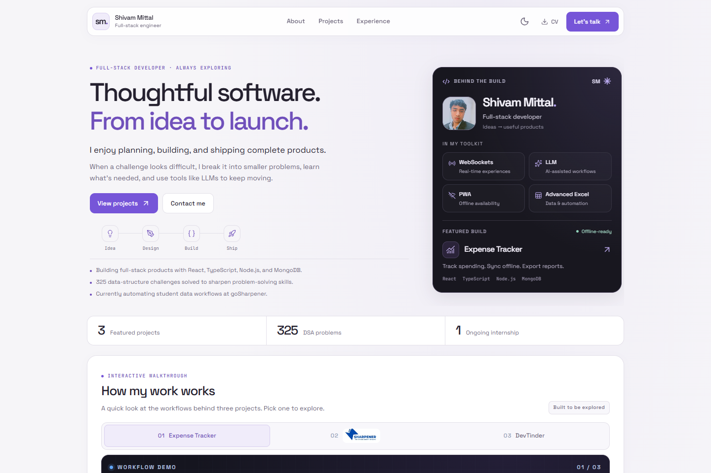
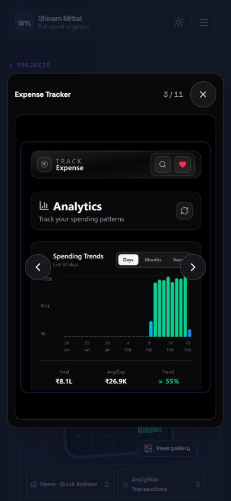

<div align="center">


# Shivam Mittal · Portfolio

**Thoughtful software. From idea to launch.**

A personal portfolio with interactive project walkthroughs, detailed case studies, and pages that keep working offline.

[Explore the website](https://www.theshivam.dev) · [View projects](https://www.theshivam.dev/projects) · [Get in touch](https://www.theshivam.dev/contact)


</div>

<picture>
  <source media="(prefers-color-scheme: dark)" srcset="docs/images/desktop-dark.png" />
  
</picture>

## Contents

- [Overview](#overview)
- [Features](#features)
- [Tech stack](#tech-stack)
- [Getting started](#getting-started)
- [Commands](#commands)
- [Project structure](#project-structure)
- [Architecture and build](#architecture-and-build)
- [Customization](#customization)
- [Contact form](#contact-form)
- [SEO and routing](#seo-and-routing)
- [Offline support](#offline-support)
- [Accessibility and motion](#accessibility-and-motion)
- [Testing and QA](#testing-and-qa)
- [Deployment](#deployment)
- [Troubleshooting](#troubleshooting)
- [Contributing](#contributing)
- [License and credits](#license-and-credits)
- [Connect](#connect)

## Overview

This is the source for [theshivam.dev](https://www.theshivam.dev), my portfolio as a full-stack developer. It brings together the products I have built, the problems behind them, and what I am learning through internships, independent work, and experiments.

The portfolio is a static React application with build-time prerendering. It runs without a custom backend or database; contact messages are handled by FormSubmit. Featured projects link to their own repositories and deployments.

| Page | Route | What you will find |
| --- | --- | --- |
| Home | `/` | Introduction, skills, interactive workflows, AI learning, and interests |
| About | `/about` | Engineering approach, working style, and examples from real projects |
| Projects | `/projects` | Expense Tracker, DevTinder, NetflixGPT, mini projects, galleries, and case studies |
| Experience | `/experience` | goSharpener, AccioJob, and independent website development |
| Contact | `/contact` | Message form, email options, availability, and professional profiles |

Unknown routes have a dedicated 404 page with links back to the portfolio.

## Features

| Area | Details |
| --- | --- |
| Visual design | Responsive layouts, light/dark themes, violet accents, and persistent theme preferences |
| Interactive walkthroughs | Three workflows with six slides each: Expense Tracker, goSharpener, and DevTinder; includes playback controls and selectable student-matching rules |
| Project exploration | 21 gallery screenshots, category galleries, expandable case studies, source links, and live demos |
| Contact | AJAX submissions, native form fallback, validation, pending/success/error states, timeout handling, copy email, and Gmail/Outlook shortcuts |
| Navigation | Mobile menu, active-page indicators, focus management, Back/Forward scroll restoration, and résumé downloads |
| Accessibility | Keyboard skip link, visible focus indicators, gallery focus trapping, Escape controls, and reduced-motion support |
| Discoverability | Prerendered HTML, per-page titles and descriptions, canonical URLs, Open Graph, and Twitter cards |
| Offline use | Saved portfolio routes, cached assets, media cached on demand, an offline notice, and connection-aware form controls |

<details>
<summary>See the mobile project gallery</summary>

<p align="center">
  
</p>

</details>

## Tech stack

| Layer | Tools |
| --- | --- |
| UI | React 19, React DOM 19, TypeScript 5.9 |
| Routing | React Router 7 |
| Styling | Tailwind CSS 3.4, custom CSS, CSS variables, PostCSS, Autoprefixer |
| Icons and typography | Lucide React, custom brand icons, Space Grotesk, JetBrains Mono |
| Build and prerendering | Vite 7, React DOM server rendering, Node.js scripts |
| Offline behavior | Browser service worker, Cache Storage, online/offline subscriptions |
| Contact service | FormSubmit |
| Code quality | ESLint 9, TypeScript project checks, Node.js test runner |
| Hosting configuration | Vercel |

Exact dependency ranges are recorded in [package.json](package.json); [package-lock.json](package-lock.json) records resolved versions.

## Getting started

### Prerequisites

- Git.
- Node.js **22.12 or newer**, with npm. Vite's supported engine range also includes Node.js 20.19 or newer within the 20.x release line.

### Install and run

```sh
git clone https://github.com/shivamMittal088/portfolio.git
cd portfolio/my-portfolio/my-app
npm ci
npm run dev
```

Open the URL printed by Vite, usually `http://localhost:5173`. Run the remaining commands in this README from `my-portfolio/my-app`.

The current application requires no `.env` file or API keys. Personal details, service endpoints, and metadata are configured in source files; see [Customization](#customization).

### Preview the production build

```sh
npm run build
npm run preview
```

The preview usually runs at `http://localhost:4173`. Use this mode to verify prerendered routes, real 404 responses, and offline behavior. The development server does not register the service worker.

## Commands

| Command | Purpose |
| --- | --- |
| `npm ci` | Install the dependency versions recorded in the lockfile |
| `npm run dev` | Start Vite with live development updates |
| `npm run build` | Bundle the app, prerender route pages, and generate the service worker |
| `npm run preview` | Serve the production output locally |
| `npm run lint` | Run ESLint |
| `npx tsc -b` | Check both TypeScript projects |
| `npm run test:seo` | Build and verify route HTML, metadata, social images, and routing configuration |
| `npm run test:offline` | Build and run the service-worker tests |

`npm run build` uses Vite and the generation scripts; run the TypeScript check separately before releasing changes.

## Project structure

```text
portfolio/
├── QA_REPORT.md                         # Browser QA findings and fix verification
└── my-portfolio/
    └── my-app/                          # Application and deployment root
        ├── Components/
        │   ├── Layout.tsx               # Shared shell, metadata, scroll, and focus
        │   ├── NavBar.tsx / Footer.tsx
        │   ├── Hero.tsx / About.tsx
        │   ├── Projects.tsx             # Project data, galleries, and case studies
        │   ├── Experience.tsx / Contact.tsx
        │   ├── WorkInMotion.tsx         # Interactive workflow controller
        │   ├── *Showcase.tsx / *Slides.ts # Workflow scenes and slide definitions
        │   └── *.css                    # Component-specific styles
        ├── src/
        │   ├── App.tsx                  # Route definitions
        │   ├── main.tsx                 # Hydration and service-worker registration
        │   ├── ssr.tsx                  # Build-time route rendering
        │   ├── useOnlineStatus.ts
        │   ├── index.css / design.css   # Base styles and interactions
        │   ├── theme.css                # Light/dark design tokens
        │   └── studio.css               # Page composition and responsive styles
        ├── public/                      # Résumé, portrait, logos, and project media
        ├── docs/images/                 # README screenshots
        ├── scripts/                     # Prerendering, worker generation, and checks
        ├── index.html                   # HTML shell and initial theme setup
        ├── seo.config.json              # Site URL and route metadata
        ├── vite.config.ts               # Build setup and production preview routing
        └── vercel.json                  # Route rewrites and service-worker header
```

`dist/` is generated build output and is excluded from version control.

## Architecture and build

1. **Bundle:** Vite produces the browser JavaScript, CSS, and public assets in `dist/`.
2. **Prerender:** `scripts/generate-route-pages.mjs` renders `PortfolioRoutes` through `src/ssr.tsx`. It writes an HTML page for each route in `seo.config.json`, plus `404.html`, with page-specific metadata.
3. **Generate offline support:** `scripts/generate-service-worker.mjs` hashes the built files and the worker template, then writes a versioned `dist/sw.js` with its core cache list.
4. **Hydrate:** In the browser, `src/main.tsx` hydrates the prerendered content. React Router handles subsequent navigation.
5. **Register the worker:** Production pages register the service worker after loading. Pages remain usable online if registration or browser storage is unavailable.

The deployed site serves static files; build-time rendering does not require a persistent server.

## Customization

| Change | Edit |
| --- | --- |
| Name, introduction, highlights, and profile card | [Components/Hero.tsx](Components/Hero.tsx) |
| Approach and background | [Components/About.tsx](Components/About.tsx) |
| Employment and freelance work | [Components/Experience.tsx](Components/Experience.tsx) |
| Featured projects, screenshot paths, case studies, and repository links | [Components/Projects.tsx](Components/Projects.tsx) |
| Workflow scenes and slide content | `Components/WorkInMotion.tsx`, showcase components, and slide definition files |
| Skills, interests, and current learning | `Components/TechnicalSkills.tsx`, `Interests.tsx`, and `AILearning.tsx` |
| Email, contact profiles, and form settings | [Components/Contact.tsx](Components/Contact.tsx) |
| Brand, navigation, and footer profiles | `Components/NavBar.tsx` and `Components/Footer.tsx` |
| Colors and theme tokens | [src/theme.css](src/theme.css) |
| Spacing, page composition, and responsive rules | [src/studio.css](src/studio.css) |
| Site URL, page titles, and descriptions | [seo.config.json](seo.config.json) |
| Initial theme, favicon, and shared social metadata | [index.html](index.html) |
| Résumé, profile photo, and project media | [public/](public/) |

Keep `seo.config.json`, the shared metadata in `index.html`, and the contact form's hidden `_url` value consistent when changing the domain. Replace `public/Resume.pdf` to update the downloadable résumé. Asset paths and filename casing must match the references in the components.

Theme selection is saved under the `portfolio-theme` local-storage key. On the first visit, the initial theme follows the browser's color preference when storage is available.

## Contact form

The form sends messages to `shivamofficialsm@gmail.com` through [FormSubmit](https://formsubmit.co/).

### Configure delivery

1. Update the `email` constant in `Components/Contact.tsx` if using another recipient. The AJAX endpoint, fallback action, and compose links derive from it.
2. Update the hidden `_url` and `_subject` fields as needed. Keep the separate footer email link in sync.
3. Deploy the site and submit a test message.
4. Open FormSubmit's activation email in the recipient inbox and confirm the address. Check spam if it is missing.
5. Submit another test message and confirm it reaches the inbox.

### Submission behavior

- JavaScript submits to the AJAX endpoint so the visitor stays on the page. A standard HTML form action is available without JavaScript.
- Name, email, and message are required; the message must contain 10–3,000 characters.
- A hidden honeypot field helps filter automated submissions.
- While sending, fields are read-only and the submit button is disabled.
- Success clears the form. Error, activation, and timeout states offer a fallback and preserve the entered message.
- Requests time out after 20 seconds; leaving the page aborts the active client request.
- Offline submission is disabled. Messages are not queued for later delivery.

Submitted names, email addresses, and messages are sent to FormSubmit. Theme preferences use local storage, saved pages use Cache Storage, and web fonts load from Google Fonts. This repository does not configure an analytics service.

## SEO and routing

[seo.config.json](seo.config.json) defines the public site URL and metadata for the five portfolio routes. Production HTML includes meaningful page content, titles, descriptions, canonical URLs, and social tags before JavaScript loads. The shared layout updates metadata during client-side navigation.

The 404 page uses `noindex, follow`. Vercel rewrites each known subpage to its generated HTML file; unknown URLs should keep their HTTP 404 response.

Routes are case-sensitive. Use canonical lowercase paths such as `/about`; mixed-case variants such as `/About` render the 404 page, consistent with the host and metadata lookup.

To add a page:

1. Create the page component and add its route to `src/App.tsx`.
2. Add its title and description to `seo.config.json`.
3. Add the corresponding route rewrite to `vercel.json`.
4. Add navigation links where appropriate.
5. Build and run `npm run test:seo` and `npm run test:offline`.

The generated offline route list follows `seo.config.json`. The current route generator accepts `/` and lowercase route names such as `/about` or `/case-studies`.

## Offline support

Offline support is enabled in production builds on HTTPS or localhost.

| Resource | Cache behavior |
| --- | --- |
| Five portfolio routes | Saved during worker installation; online navigation refreshes the saved route |
| Built CSS/JavaScript and selected core images | Saved during installation |
| Images already loaded before the worker takes control | Replayed through the active worker so they can be saved |
| Other gallery images and résumé | Saved on demand when requested through the active worker |
| Unknown, unsaved routes | Use the offline fallback page when the network is unavailable |
| Contact requests and external destinations | Require a connection |

Unseen gallery media is not downloaded in advance. The worker uses saved assets when available, and a content-derived cache name changes when the build changes. Activation removes older portfolio caches.

To check offline behavior:

1. Run `npm run build` and `npm run preview`.
2. Open the site online and wait for the service worker to become active.
3. Visit a gallery or download the résumé if you want those resources available offline.
4. Switch the browser's Network panel to **Offline**.
5. Reload `/about`, `/projects`, and `/contact`; confirm the pages load and the form is disabled.
6. Reconnect and confirm the form becomes available again.

The current project provides offline browsing without an install manifest or push-notification flow.

## Accessibility and motion

- The first Tab reveals **Skip to main content**; activating it moves keyboard focus past the shared header.
- Navigation indicates the current page, and route changes focus the new page heading.
- Escape closes the mobile menu and returns focus to its toggle.
- Gallery dialogs have accessible labels, contain keyboard focus, make the background inert, and restore focus when closed.
- Arrow keys move through gallery screenshots; Escape closes the gallery. Close controls have a 44 × 44 pixel target.
- Contact fields have labels, and submission feedback uses status or alert announcements.
- `prefers-reduced-motion` disables or reduces animations and pauses walkthrough autoplay. Playback controls also allow visitors to pause motion.

Prerendered content remains available without JavaScript. Interactive walkthroughs, galleries, theme switching, and the mobile menu require JavaScript; the contact form retains its native submission fallback.

## Testing and QA

Run the checks against one build to avoid rebuilding for each test command:

```sh
npm run lint
npx tsc -b
npm run build
node scripts/verify-route-pages.mjs
node --test scripts/verify-service-worker.test.mjs
```

The SEO checks cover generated route content, metadata, social image availability, Vercel rewrites, and the 404 page. The seven service-worker tests cover installation, on-demand media caching, offline navigation, and cache-storage failures.

Browser QA on **20 October 2026** covered all five pages, both themes, widths from 320 to 1440 pixels, project galleries, walkthroughs, contact response states, downloads, keyboard controls, and offline reloads. The three resulting findings were fixed and verified in Chrome and Edge. See the [QA report](../../QA_REPORT.md) for scope and evidence.

For future UI changes, check:

- Navigation, direct-page reloads, Back/Forward behavior, and unknown URLs.
- Mobile layouts, both themes, and visible keyboard focus.
- Gallery controls, focus restoration, long category titles, and case-study disclosures.
- Walkthrough selection, playback controls, and reduced-motion settings.
- Contact validation, pending/error/timeout states, and offline/reconnect behavior.
- Résumé downloads and external project links.

Contact UI states were verified with intercepted responses; live delivery and activation still need an inbox check. Safari, Firefox, physical mobile devices, and screen-reader speech output were outside that QA pass. Temporary browser scripts and screenshots under the repository's `.tmp/` directory are local artifacts, separate from the checked-in test commands above.

## Deployment

### Vercel

Import the repository and use these settings:

| Setting | Value |
| --- | --- |
| Root directory | `my-portfolio/my-app` |
| Framework preset | Vite |
| Install command | `npm ci` |
| Build command | `npm run build` |
| Output directory | `dist` |
| Node.js | A version satisfying the prerequisites above |
| Environment variables | None required by the current application |

[vercel.json](vercel.json) supplies the known-page rewrites and a `Cache-Control: no-cache` header for `/sw.js` so browsers can check for worker updates.

Before publishing, verify the domain metadata, contact recipient, résumé, and public links. After deployment, open each route directly, confirm an unknown URL returns 404, activate the contact form if needed, and check one offline reload.

### Other static hosts

Build locally or in the host's build pipeline and publish the contents of `dist/`. Serve known routes from their generated `index.html` files, use `404.html` for unknown URLs, serve `/sw.js` without a long-lived immutable cache policy, and enable HTTPS. Preserve the real 404 response rather than sending every URL to the homepage.

## Troubleshooting

| Symptom | What to check |
| --- | --- |
| Build fails with a Node engine error | Check `node --version`, use a compatible version, and reinstall with `npm ci` |
| A route works through links but fails on reload | Verify the host serves the generated route HTML and uses the Vercel rewrites or equivalent rules |
| Contact form reports pending verification | Activate the recipient through FormSubmit's confirmation email |
| Contact form errors or times out | Reconnect, retry, or use the email shortcuts; the entered message remains available |
| Offline behavior is missing during development | Use the production build and preview; check that the worker has activated |
| A screenshot or résumé is unavailable offline | Load that resource online through the active worker first |
| Old content persists during local testing | Check the active worker and cache in browser devtools; unregister it and clear site data for a clean test |
| Images work locally but fail after deployment | Match the exact `public/` filename, folder casing, and component reference |
| Clipboard access is unavailable | Use HTTPS or localhost and browser permissions, or select the visible email address |

## Contributing

For bugs, open an [issue](https://github.com/shivamMittal088/portfolio/issues) with the affected route, browser, viewport, theme, and steps to reproduce. Screenshots help with layout issues.

For changes, use a focused branch, follow the existing TypeScript/component conventions, run the checks above, and describe the resulting behavior and verification in the pull request. Keep generated `dist/`, `node_modules/`, and local QA artifacts out of commits.

## License and credits

No `LICENSE` file is currently included; licensing terms have not been specified in this repository. Personal photographs, résumé content, project screenshots, and third-party logos remain attributed to their respective owners.

Built with React, Vite, Tailwind CSS, React Router, and Lucide. Typography uses Space Grotesk and JetBrains Mono through Google Fonts. Contact delivery uses FormSubmit.

## Connect

[Website](https://www.theshivam.dev) · [GitHub](https://github.com/shivamMittal088) · [LinkedIn](https://www.linkedin.com/in/shivammittal088) · [Email](mailto:shivamofficialsm@gmail.com)
